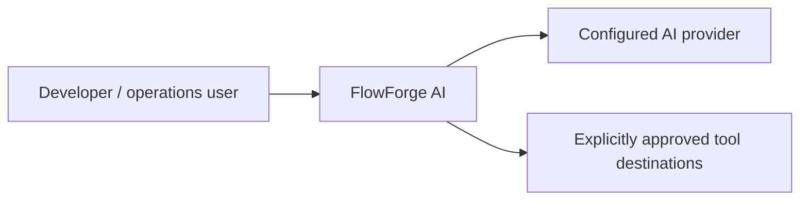
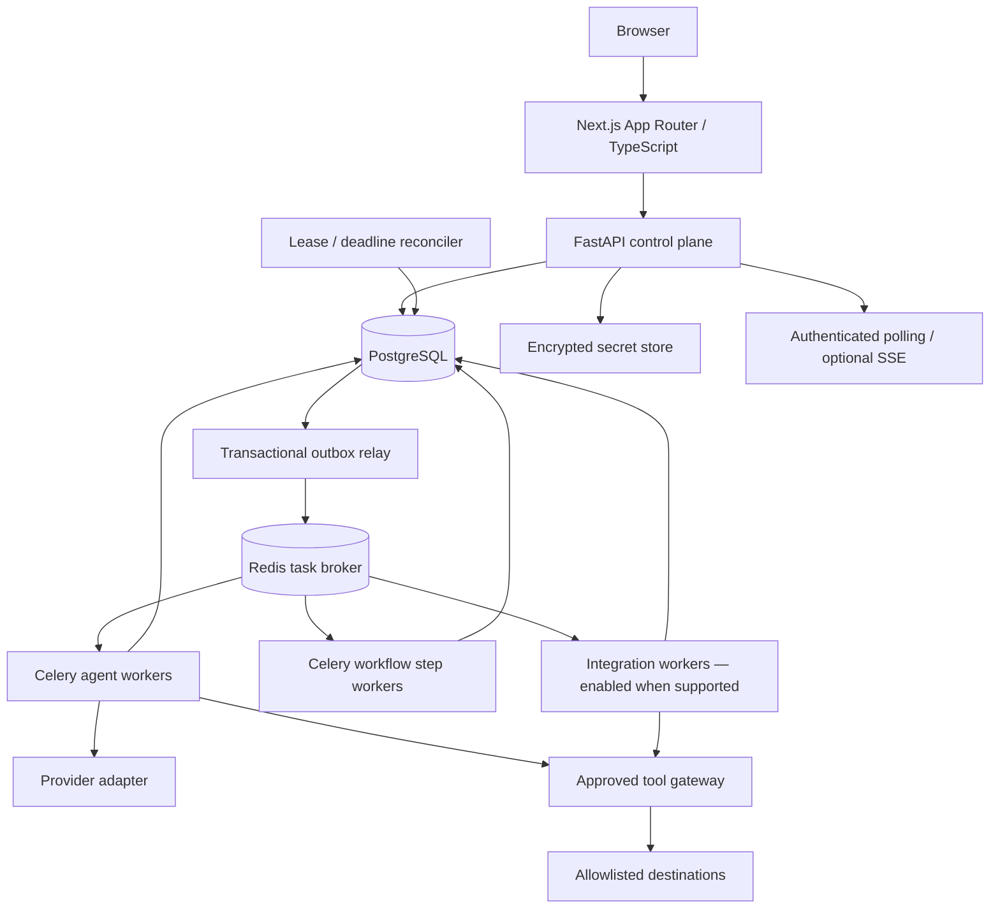
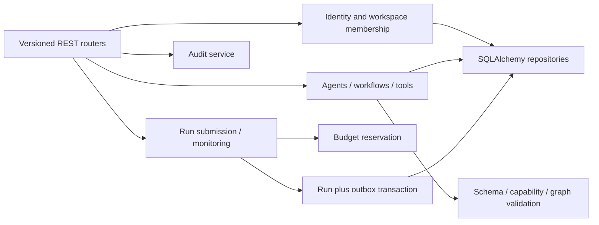

# Architecture proposal

Initial sketch, superseded by the [final technical architecture package](technical-architecture/README.md).

## C4 level 1 — context

## C4 level 2 — containers

## C4 level 3 — control-plane components

## Boundaries

Modular monolith modules: identity, workspaces, agents, tools, workflows, executions, integrations, artifacts, usage and audit. Definitions hold configuration; executions hold runtime state; worker delivery mechanics wrap domain services. HTTP handlers submit work and return 202; they never host agent loops. Runtime workers use restricted DB roles and separate egress policies; browser sessions cannot directly dispatch broker messages. Revalidate current revocation and permissions before effects while pinning immutable execution definitions.

Frontend organization: `frontend/src/app`, `features/{agents,workflows,executions,tools,integrations,settings}`, `components/{ui,shared}`, `lib/{api,auth,config}`. Backend organization: `backend/app/{api,modules,runtime,workers,core}` plus migrations and tests. No source scaffold exists yet.

## Worker topology and reliability

Queues: agents, workflow_steps, integrations. Start separate Celery processes with explicit queue assignment, bounded concurrency, task deadlines and memory limits. Workflow orchestration schedules ready steps; agent workers run bounded model/tool loops; no worker waits synchronously for child task completion. Integration pool stays off until connectors ship.

PostgreSQL transactions create run, budget reservation and outbox event together. Relay publishes at least once and marks delivery; duplicate dispatch is expected. Workers atomically claim steps using attempt leases/fencing tokens; stale attempts cannot commit outputs. Reconciler detects expired leases/deadlines and makes retry/failure decisions from persistent state. Redis loss cannot erase run truth. Provider/tool side effects require destination idempotency support or explicit non-retry policy.

Docker Compose proposal: frontend, api, postgres, redis, outbox relay, reconciler, agent worker and workflow worker. Migration job runs once before API readiness. Health probes separate process liveness from DB/broker readiness. Production secrets come from deployment secret storage. Structured logs carry request_id, workspace_id, run_id, step_id and attempt without input secrets.
