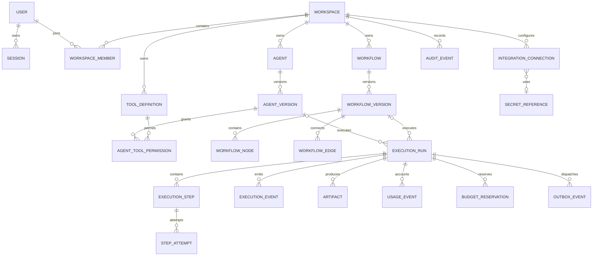

# Database proposal

Initial sketch, superseded by the [final data model](technical-architecture/02-DATA.md).

PostgreSQL; SQLAlchemy 2.x; Alembic migrations. UUID primary keys, UTC timestamps, decimal USD accounting, JSONB schemas/graph snapshots. This is a proposed model, not a deployed database.

## Important fields and constraints

- User: normalized unique email, password hash, created_at. Session: token hash only, user_id, expires_at, revoked_at.
- WorkspaceMember: workspace_id/user_id unique, role enum. Preserve at least one owner transactionally.
- Agent/Workflow: workspace_id, name, description, draft JSON, draft_revision, archived_at. Separate mutable draft from immutable versions.
- AgentVersion: agent_id/version unique; instructions, provider/model ID, capability snapshot, input/output schema, limits and definition hash. Permissions pin tool versions and restricted scopes.
- ToolDefinition: workspace_id, tool_key/version unique, schema, policy, timeout, secret reference; deny by default. SecretReference stores opaque locator and key version, never plaintext credential.
- WorkflowVersion: workflow_id/version unique; graph snapshot, definition hash, validation result and creator. Node: version_id/node_key unique, type, config, schemas, policy, position. Edge: version_id/source/target/port mappings, optional branch. Composite FKs prevent edges crossing versions.
- ExecutionRun: workspace_id, exactly one agent_version_id/workflow_version_id, state, input reference, output reference, limits, correlation_id, requested_by, cancel_requested_at, started_at, finished_at, retry_of_run_id. Check constraint enforces exclusive definition reference.
- ExecutionStep: run_id/node_key unique, state, selected_branch, output/error reference. Attempt: step_id/attempt_no unique, lease_owner, fencing_token, lease_expires_at, deadline, state and error_code.
- ExecutionEvent: run_id/sequence unique, event_type, timestamp, sanitized payload. Append-only order supports reconnect cursors.
- BudgetReservation: workspace/run, reserved amount, settled amount, status; atomic check prevents concurrent overspending. UsageEvent deduplicates by provider request/attempt and separates estimated from final costs.
- OutboxEvent: event key unique, payload reference, available_at, published_at, attempts. AuditEvent: actor, action, target and sanitized metadata.

Every tenant-owned table carries workspace_id or a constraint-enforced parent path. Composite ownership keys and repository scope checks prevent cross-tenant references. Immutable versions cannot be edited; archive instead of cascading deletion into execution history.

Indexes: membership(user_id, workspace_id); runs(workspace_id, created_at DESC, id DESC), runs(workspace_id,state); steps(run_id,state); attempts(lease_expires_at,state); events(run_id,sequence); outbox(published_at,available_at); audit(workspace_id,created_at). Cursor pagination uses stable time plus UUID tie-breaker.

Transactions cover publication, run/outbox creation, dependency readiness, budget reservation/settlement and terminal state updates. Retention/redaction policies must cover input/output artifacts, logs and backups; workspace deletion requires a separately reviewed retention flow.
