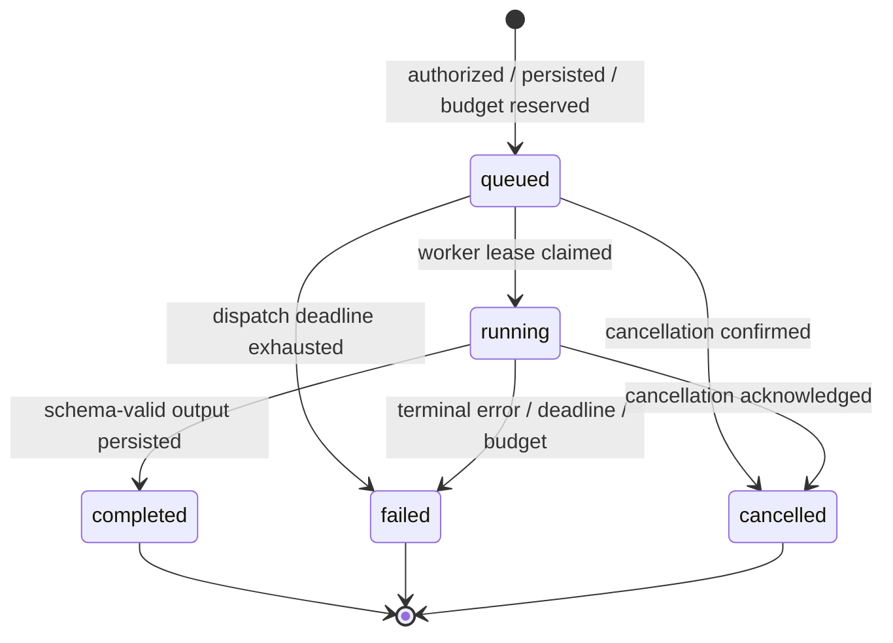

# Execution model

Initial sketch, superseded by the [final execution and recovery design](technical-architecture/04-EXECUTION.md).

## Agent run state machine

Terminal transitions use compare-and-set in PostgreSQL. Cancellation requests do not instantly imply cancellation. Completion racing cancellation has one persisted winner. A retry creates a separate run linked to the original; terminal runs never revert to running.

Agent loop: resolve immutable version → validate input → check current permissions → reserve allowed spend → invoke provider with deadline → validate structured output/tool request → check schema, scope and destination → execute approved tool → persist sanitized event/usage → repeat within iteration cap → validate final output → settle budget and finish. Each model/tool call checks cancellation and remaining time. Provider cancellation is best effort; reconcile usage for responses arriving after cancellation.

Trace records instructions/version identifiers, call metadata, permitted tool arguments with redaction, result summaries and failures. Do not capture or display private chain-of-thought. Provider text and retrieved content are untrusted data, not authority to add permissions.

## Workflow graph and scheduling

MVP is a directed acyclic graph. Validate unique IDs, valid endpoints, exactly one manual entry, at least one result, reachability, permitted node types, mapping schema compatibility and bounded policies. Detect cycles with topological sort. Reject unsupported configuration before publication.

On submission snapshot published version, initialize step records and persist input, budgets and outbox event. Scheduler claims eligible nodes transactionally. A step is ready only after applicable upstream dependencies finish and mappings resolve. Agent nodes schedule bounded agent work without blocking workflow workers.

Conditions produce one selected outgoing branch. Non-selected descendants become skipped unless reachable through another active dependency. Each merge explicitly declares `all` or `any_active`: `all` requires all incoming paths completed; `any_active` waits until every incoming path is terminal and at least one is completed, ignoring skipped inputs. Failed ancestors block dependent work and fail the run under MVP fail-fast policy. Result succeeds only when all required active steps complete and output schema validates.

Step states: pending → queued → running → completed/failed/cancelled; running → retrying → queued for safe transient failures; pending → skipped for inactive branches. Attempts have separate immutable outcome records; retrying is not success.

## Limits and recovery

Enforce absolute run deadline, per-step deadline, max iterations, max attempts, response size, token limits and workspace concurrency. Cost reservation uses model input upper bounds and configured output cap; reject calls without safe budget coverage. Estimates stay separate from provider final usage; uncertainty blocks further spend when required.

Retry only classified transient errors with exponential backoff/jitter, bounded by remaining deadline and attempts. Invalid input, denied permissions and hard budget failures do not retry. Non-idempotent side effects with uncertain results require inspection and cannot be blindly replayed.

Claims use leases and monotonic fencing tokens. Duplicate broker tasks cannot claim completed work; stale workers cannot commit results. External effects still need idempotency keys: database fencing alone cannot guarantee exactly-once external actions. Reconciler recovers abandoned claims and overdue runs. Cancellation prevents new scheduling, requests active interruption, records confirmed final state and releases unused reservations.

## Required tests

Cycle/mapping/branch/merge validation; denied tool calls; limits and budget races; valid structured outputs; duplicate delivery; crash after claim/before dispatch/after effect; stale attempt fencing; outbox replay; cancellation/completion race; redaction; history after worker restart. Use deterministic provider adapter for tests and separate opt-in live provider checks.
