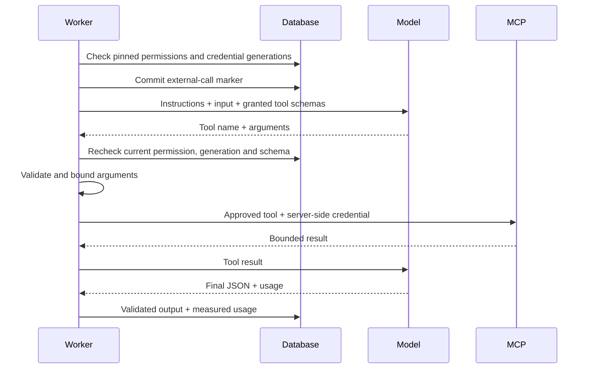

# Agent harness: MCP, provider tools and regression examples

## What changed

An agent can now choose up to eight connected, operator-approved read-only MCP tools in **Model & tools**. Publication replaces client-supplied tool metadata with a server-derived snapshot: server/tool identity, credential generation, schema hash, input schema and description. No bearer credential goes into the agent definition, model payload or run trace.

The same bounded loop supports the eleven reviewed model IDs across OpenAI, DeepSeek, Claude, OpenRouter and Gemini. The existing `local_tools` capability field now means the reviewed model can run FlowForge's tool loop; its name is retained for API compatibility. Other provider-listed models remain setup only.



Both standalone and workflow agent runs use these permission checks. Hosted agent eligibility/submission also rejects stale grants. Portable agent templates discard MCP bindings so a copy requires its own workspace connections.

## Why this design

Keep the existing application harness rather than adding CrewAI or a second orchestration framework: it already owns cancellation, budgets, durable state, traces and permission boundaries. A provider adapter translates the wire protocol, while the shared loop decides whether a call may happen. Reconsider a framework only when a demonstrated capability cannot fit this boundary without duplicating substantial logic.

Pin a schema and generation rather than silently using the latest remote tool. This prevents a published agent gaining a different contract or credential after a remote change. Reconnecting or changing an approved schema requires republishing. Reconsider this only with an explicit, audited compatibility/migration policy.

Use server-validated non-strict function schemas for MCP: existing MCP input contracts need not meet OpenAI's stricter generation-time schema subset. Arguments still pass JSON Schema validation before a remote request. Invalid arguments become a sanitized model-visible error and consume a tool attempt. Revocation, remote uncertainty and permission changes stop the run rather than inviting a retry.

Use provider-native adapters rather than treating every provider as OpenAI-compatible. Claude uses `tool_use`/`tool_result`; OpenRouter uses chat tool messages; Gemini uses function calls/responses. Gemini 2.5 discovers/calls tools first, then makes a separate native structured-output request with tools disabled. That final request consumes an iteration, tokens and budget. The final schema call starts a new user turn. DeepSeek uses its native Responses endpoint. Reasoning items from the OpenAI-compatible Responses transcript are retained.

Only one tool call executes at a time. Iteration, call-count, output-token, context-size, deadline and cost limits apply to the complete loop. A model response with multiple calls fails closed. Reconsider parallel tools when concurrency, aggregate budget reservations and cancellation can be coordinated safely.

## Regression examples

Open an agent's **History**, select a version and expand **Regression examples**. Save a named JSON array of up to twenty examples:

```json
[
  {
    "name": "Urgent outage",
    "input": {"ticket": "The service is down"},
    "expected_output": {"priority": "urgent"}
  }
]
```

Run the agent with that input through the usual run flow, then choose **Evaluate observed runs**. Scoring searches the version's latest 100 completed runs, using the most recent matching input. Results distinguish passed, failed, untested and contract failed. Example payloads are encrypted with workspace/suite-bound AES-GCM; list responses and audit events contain metadata only.

This is deterministic evidence-based regression scoring. It does not launch a model call, grade subjective quality, run an experiment automatically, or count missing evidence as success. Expected outputs must match the selected version's schemas. A future batch runner should use ordinary durable runs, explicit spend confirmation and workspace reservations; an LLM judge would need its own versioned criteria and cost accounting.

## Verification and limits

PostgreSQL tests cover server-derived grant snapshots, forbidden remote tools, rotation/revocation/schema/catalog changes, revocation after the model responds, argument validation, trace redaction and duplicate execution. Native-wire mock tests cover tool results and completion for all five provider families, including Gemini finalization limits. Regression tests cover encryption, observed evidence, invalid contracts and tenant isolation. No real provider/MCP request or paid model call was used to certify these adapters; provider-account availability still requires live acceptance testing.

Official protocol references used for implementation: [OpenAI function calling](https://developers.openai.com/api/docs/guides/function-calling), [DeepSeek Responses](https://api-docs.deepseek.com/guides/responses_api/), [Claude tool calls](https://platform.claude.com/docs/en/agents-and-tools/tool-use/parallel-tool-use), [OpenRouter tools](https://openrouter.ai/docs/guides/features/tool-calling), [Gemini function calling](https://ai.google.dev/gemini-api/docs/function-calling).
