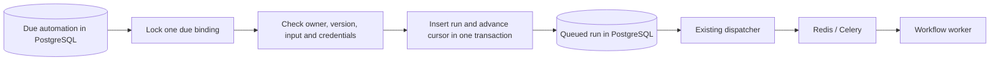

# Real workflow triggers

## From a node to a service

A trigger node describes where data enters an immutable workflow. A separate automation binds that version to a delivery mechanism. This keeps webhook secrets and operational state outside editable graphs and portable templates. Publish a workflow containing one **Webhook trigger** or **Schedule trigger**, then open **Triggers & schedules** in the workspace navigation.

Owners/admins create, pause, resume, rotate webhook keys and archive bindings. Members can inspect metadata/history. Losing the creator's owner/admin role blocks new deliveries; schedules pause with a diagnostic. Restoring access permits explicit resume. Bindings always target one published version; publish/create a new binding when changing the graph.

## Authenticated JSON webhooks

Creation reveals a random `ff_hook_` key once. PostgreSQL retains its SHA-256 hash. The sender stores the key in its server-side secret store and makes:

```http
POST /api/v1/webhooks/{automation_id}
Authorization: Bearer YOUR_WEBHOOK_KEY
Idempotency-Key: ticket-event-0001
Content-Type: application/json

{"ticket":"The service is down"}
```

The body is the workflow input object, bounded to 64 KiB and checked against the published input schema. The event key must have 8–128 characters without spaces. Use the same event key when retrying a delivery. The first accepted event returns 202 with a run ID. A duplicate with the same input returns 200 with the same ID. A changed body under that key returns 409. Identity is scoped to this automation so different webhooks can use the same upstream event ID.

Poll `GET /api/v1/webhooks/{automation_id}/runs/{run_id}` with the same bearer key. The key cannot read another automation's run. Redis enforces 60 submissions and 240 polls per minute; rate limiting fails closed when Redis is unavailable. PostgreSQL contains the accepted run, so a broker restart cannot erase acceptance. Rotation invalidates the previous key. Pause/archive rejects subsequent delivery, including retries; already accepted runs continue and can be cancelled in Executions.

Bearer authentication is appropriate for generic server-to-server senders. Provider-specific signature checks, raw-body HMAC validation, timestamp/replay windows and verification handshakes belong to connector-specific receivers. This endpoint does not claim compatibility with every third-party webhook format. Public use requires HTTPS and deployment capacity controls.

## Persistent interval schedules

Choose an interval from 60 to 86400 seconds and input JSON matching the published workflow. The first due time is creation time plus the interval. Time calculations are UTC intervals, so daylight-saving changes do not shift the cadence. The input is encrypted and bound to this workspace/automation. Model steps can incur provider charges on each occurrence.

The existing maintenance service handles due schedules; no extra scheduler service is required. Each transaction locks one due binding using `FOR UPDATE SKIP LOCKED`, checks current permissions and executable dependencies, inserts the ordinary workflow run with a deterministic slot key, advances the cursor, and commits. It then releases those locks before claiming another binding. This permits concurrent maintenance workers without duplicate accepted slots or holding locks across multiple workspaces.



If maintenance crashes before commit, both changes roll back and the same slot remains due. After commit the existing run dispatcher recovers delivery independently of the schedule. Missed intervals coalesce into one run at recovery; the next due time stays on the original interval anchor. Resuming a schedule can therefore accept one overdue run immediately. This deliberately avoids a catch-up burst of paid calls. Workspace concurrency pressure retains the same due slot and retries dispatch after ten seconds. Invalid credentials, version dependencies or creator access pause delivery with an error code.

This is durable acceptance and at-most-one accepted run per slot/event key. It does not promise exactly-once external effects. The workflow's external-call marker still prevents automatic replay after an ambiguous provider/tool outcome.

## Decisions and alternatives

Use PostgreSQL rather than Celery Beat as the schedule authority: it already owns workspace state, constraints and durable runs, and supports an atomic cursor/run transaction. Redis-only schedules would add a second source of truth. Reconsider a dedicated scheduling system when cron/calendar rules, large due queues or regional execution exceed this bounded interval service.

Use explicit published-version bindings rather than following the draft/latest version: production automation changes must be intentional and reviewable. Reconsider optional version aliases only after adding audited promotion and rollback.

The local limit is fifty unarchived bindings per workspace. Archive removes a binding from active lists and capacity counting while retaining run references/audit evidence. No automatic deletion of run history occurs. Cron expressions with IANA timezones are now available; see [calendar schedules](22-CRON-SCHEDULES.md). Signed-provider receivers, payload transformations, dead-letter event inboxes and workspace monthly quotas remain future work.

## Tests

Integration tests use isolated PostgreSQL and Redis. They verify deduplication/conflict, schema rejection, key rotation, pause/resume/archive, tenant and webhook-run isolation, encrypted input, downtime coalescing, concurrent scheduler claims, rollback between run insertion/cursor advance, concurrency backpressure, permission loss and invalid-target diagnostics. Migration `0018` is additive. These checks exercise service behavior without external accounts or paid calls.
