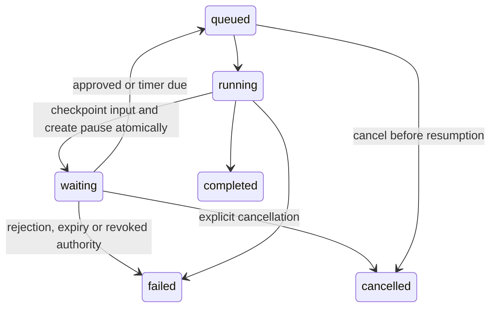

# Human approvals, durable timers and workspace activity

This phase adds two real workflow nodes and a governance screen. An approval is a durable decision about the saved input of an immutable published workflow; a timer is a durable instruction to continue later. Neither keeps a Celery worker sleeping.

## Try the complete local flow

1. Open **Templates → Review and release** and create a draft. The starter requires no provider key or external account.
2. Select **Review record**. Independent review is the default: another workspace owner/admin must approve. For a single-person local test, explicitly enable **Allow the run requester to approve** before publishing.
3. Publish and run with this input:

```json
{"customer":"Ada","request":"Release the prepared customer profile"}
```

4. Open **Executions → Workflow runs** and select the run. It becomes **waiting**. Choose **Inspect saved input**; the exact encrypted checkpoint input appears beside the decision buttons.
5. Approve to continue, or reject to end the run. Approval resumes through a five-second timer, then returns the same object. The timer resumes on the maintenance cycle, so its wall-clock completion is approximate.
6. Open **Settings → View activity log**. Filter by `workflow_pause.approved` to inspect the decision receipt. **Export this page** downloads a JSON file containing the displayed events and pagination cursor. It does not export credentials or execution input.

## State and recovery



The worker commits a `workflow_pause` row and the waiting checkpoint under the root run lock, clears the worker claim, then exits through an explicit control exception. PostgreSQL is the source of truth. Redis redelivery cannot claim a waiting run. Timer maintenance finds due rows with row locks; duplicate maintenance cycles cannot release a timer twice.

A decision locks the same run first. The first valid decision wins; an identical retry by its reviewer returns the existing result, while a conflicting decision returns a conflict. Expiry is checked in the API as well as maintenance. Cancelling a parked run settles its pause and unfinished checkpoints immediately. Removing the run requester's authority or revoking its deployment prevents resumed work; demoting a reviewer before the approved node is consumed also prevents continuation.

Approval is bound to the scoped node ID and a canonical input hash, as well as the run's immutable published version. Incoming data passes through unchanged. A different input cannot consume the saved approval. Editing a draft never changes a pending run. Decisions are made through authenticated workspace sessions with CSRF protection, not through hosted bearer keys or public callback URLs.

Loops and reusable workflows use the same root ledger. Each loop item has its own scoped pause/decision. Previously completed item outputs and external receipts are reused. Unknown external outcomes still fail conservatively and are never automatically retried. Publication and resumption continue to check current tool grants and credentials.

## Time and money are separate limits

Each timer allows 1–86,400 seconds. Each approval allows 60–86,400 seconds before expiry. Worst-case combined durations across all branches and allowed loop items must fit within **24 hours**. These nodes have one attempt and require a published run; previews and isolated node tests cannot approve a request, sleep a worker or bypass durable receipts.

Actual parked duration is excluded from active execution limits: release shifts the root deadline and saved scope/node deadlines by that duration in one transaction. The remaining active execution window is preserved; it is not replaced by a fresh budget. Queue delays and recovery outside a parked state still count against active deadlines. A delayed timer after maintenance downtime resumes from its stored due time, rather than starting another full delay. Downtime can make actual elapsed wall time exceed the configured worst-case delay.

A parked run retains its workspace run slot and unspent model reservation. This makes concurrency and spending limits predictable without introducing a second scheduling/admission system for the local release. It frees the worker, not the workspace's execution capacity. Cancel or resolve parked runs when slots are needed. Reservations remain counted across midnight. For runs completing on a later UTC day, the complete recorded cost is also counted on that completion day; this deliberately conservative quota policy can count earlier spend again. It is a spending guard, not an invoice ledger.

## API and data changes

- Migration `0023`: `workflow_pause`, waiting run/checkpoint states and the active-workspace index including waiting runs. It preserves previous immutable graphs and encrypted evidence. Downgrade refuses when decision history exists.
- `GET /api/v1/workspaces/{workspace}/workflow-runs/{run}` includes `requested_by` and typed `pauses`. Step evidence reports waiting status.
- `POST /api/v1/workspaces/{workspace}/workflow-runs/{run}/approvals/{pause}/decision` accepts `{"decision":"approve"}` or `{"decision":"reject"}`. Only current owners/admins may decide; requester separation is checked server-side.
- `GET /api/v1/workspaces/{workspace}/activity` supports an exact `action`, a bounded `limit` of 1–100 and a stable timestamp/ID cursor. Only owners/admins can read/export activity. No delete/update endpoint is exposed.
- Call options and graph readiness carry `has_pause`, including nested dependencies, so the builder disables unsafe previews before a run is submitted.

## Decisions and alternatives

Explicit pause rows fit the current modular monolith and existing maintenance loop. Sleeping Celery tasks would waste workers and lose convenient control over recovery; introducing Temporal or another orchestrator solely for these bounded waits would add deployment and operational cost. Reconsider that choice when customer flows require weeks of waiting, high fan-out, callbacks, compensation or stronger orchestration tooling.

Fixed owner/admin review uses the existing role system and is straightforward to audit. Reviewer groups, quorum decisions, action-specific permissions, email/Slack notifications, delegation and real-time collaboration remain future extensions. The current activity screen is paginated JSON export rather than a bulk warehouse or compliance retention service. Add retention controls, tamper-evident storage and a stable bulk-export job when those become actual requirements.

Holding the existing reservation avoids an unsafe resume that admits new work without capacity or loses its original funding. Reconsider when parked workflows routinely block useful concurrency; a separate parked-run quota and transactional resumption queue should then replace the policy together, with tests covering calendar budget boundaries and starvation.

## Verification

Database-backed regressions cover decisions, rejection, expiry without maintenance, cancellation, duplicate delivery/ticks, role and workspace boundaries, independent review, revoked requester/reviewer permission, input binding, nested item pauses, expansion limits, resource reservations across midnight, and reuse of completed HTTP receipts. Activity tests cover deterministic cursor ties, filters, authorization and exclusion of execution input from decision audit details. A live local worker was also exercised through approval, timer and result with four durable checkpoints; no external service or paid model was invoked.
