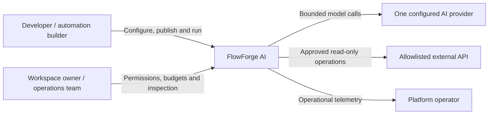
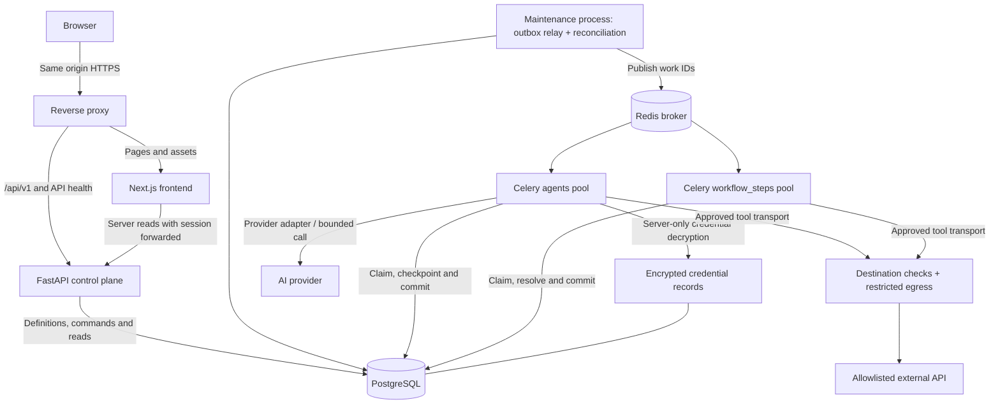
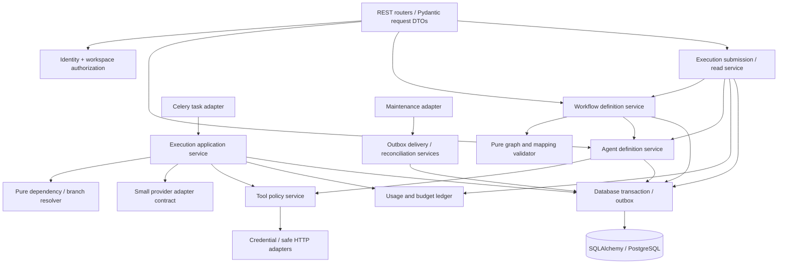

# 01 — system boundaries and project structure

## Mental model

The frontend is the control panel. FastAPI is the authority that checks and records commands. PostgreSQL is the durable ledger. Redis is the delivery mechanism, and Celery workers perform bounded work. A green node on the canvas represents a committed execution result, not a browser animation or a broker acknowledgement.

## C4 system context



External write operations are a future capability requiring a separate approval mechanism. Test adapters and example graphs are clearly labeled; they are not real integration results.

## C4 container diagram

Here “container” means a runnable application or data store, not necessarily a separate codebase or a microservice.



The encrypted credential records live in PostgreSQL initially; a mounted encryption key is separate from database backups. A managed secret store can replace that storage adapter later. Egress is a security policy/transport boundary, not a proposed new microservice. The API, workers and maintenance process use the same backend distribution and migrations, with different entry points and database privileges.

## C4 component diagram — backend



Pure means the function can decide from supplied data without HTTP, database or Celery access. This makes graph validation and state transitions inexpensive to test. FastAPI supports decomposing routes through routers; the module boundaries below are our project design, not a required FastAPI pattern. [FastAPI larger applications](https://fastapi.tiangolo.com/tutorial/bigger-applications/).

## Proposed repository tree — documentation only

```text
FlowForge AI/
  frontend/
  backend/
  infra/                   reverse proxy and image configuration
  docs/                    product design, architecture, decisions and status
  .github/workflows/       CI, when implemented
  compose.yaml             when implemented
  .env.example             variable names and safe examples only
```

No directories in the proposed application tree are being scaffolded now.

## Backend layout

```text
backend/
  app/
    main.py                FastAPI composition root
    api/                   v1 router assembly, errors, request context
    core/                  settings, DB transaction/session, clock, logging
    modules/
      identity/            credentials, sessions, CSRF
      workspaces/          ownership, members, authorization policy
      agents/              drafts, snapshots, model capability validation
      tools/               registry, immutable tool versions, grants, transport
      workflows/           drafts, typed graph, mappings, publication
      executions/          runs, steps, attempts, scheduler, events, recovery
      usage/               accounts, reservations, settled/uncertain charges
      integrations/        provider connection metadata and encrypted secrets
      artifacts/           bounded sensitive input/output access
      audit/               append-only security/business events
    providers/             one real adapter and test adapter
    workers/               Celery app, task names, queue routes
    maintenance/           outbox and reconciliation entry point
  migrations/              Alembic
  tests/
    unit/
    integration/
    recovery/
    security/
```

Within an implemented module, begin with `router.py`, `schemas.py`, `service.py`, `models.py`, `repository.py`, and `domain.py` only when needed. Domain may be absent in simple CRUD modules. Do not create empty layers or a generic repository superclass. SQLAlchemy repositories are concrete; the provider transport is an interface because a real external boundary and a deterministic test substitute already exist.

## Dependency rules

1. Routers translate HTTP; services apply use cases; repositories persist. Routers do not directly enqueue tasks or write ORM rows.
2. Domain rules never import FastAPI, Celery, HTTP clients or frontend types. Pydantic contract types may live at module boundaries; pure transitions use simple values/typed records.
3. Modules call another module's narrow public service/contracts, never its internal repository or ORM tables. For performance, an explicitly owned read-model query may join tables; it cannot become an alternate write path.
4. `core` has no feature imports. Infrastructure composition wires dependencies; domain services do not discover them globally.
5. Dependency order: identity → workspaces; integrations → workspaces; tools → integrations/workspaces; agents → tools/workspaces; workflows → agents/tools/workspaces; executions → workflows/agents/tools/usage/artifacts. Usage/artifacts/audit expose narrow services and do not import executions. Core transaction participation is injected so these services can share one transaction without cyclic imports.
6. Outbox rows are transport-neutral database records. Celery adapters accept IDs and invoke execution services. Runtime code does not call `.delay()` or `AsyncResult.get()`.
7. Backend import-boundary tests enforce these rules. Add an exception only as a documented decision.

## Frontend tree and route map

```text
frontend/src/
  app/
    layout.tsx
    (marketing)/page.tsx                          /
    (auth)/login/page.tsx                         /login
    (auth)/register/page.tsx                      /register
    (workspace)/w/[workspaceId]/
      layout.tsx
      overview/page.tsx
      agents/page.tsx
      agents/new/page.tsx
      agents/[agentId]/page.tsx
      agents/[agentId]/edit/page.tsx
      agents/[agentId]/test/page.tsx
      workflows/page.tsx
      workflows/[workflowId]/edit/page.tsx
      workflows/[workflowId]/validation/page.tsx
      executions/page.tsx
      executions/[runId]/page.tsx
      tools/page.tsx
      tools/[toolId]/page.tsx
      integrations/page.tsx
      usage/page.tsx
      settings/page.tsx
      loading.tsx / error.tsx / not-found.tsx
  features/
    auth/ workspaces/ agents/ workflows/ executions/ tools/ integrations/ usage/ settings/
  components/ui/                                  shadcn primitives
  components/shared/                              shell, badges, errors, budgets
  lib/api/                                        generated DTOs and fetch wrappers
  lib/auth/                                       server session forwarding helpers
  lib/config/                                     public/server config boundaries
```

Route groups organize layouts without changing URLs. Version history is initially an agent-detail tab (`?tab=versions`), rather than another screen tree. Settings tabs use query state. Add new routes when sharing/deep linking needs them. The 15 product screens map directly to the approved design.

## Server/client and request boundaries

| Area | Server responsibility | Client responsibility |
|---|---|---|
| Marketing | Static content, metadata, example labels | Optional example interactions |
| Workspace shell | Session-aware initial API reads, redirects, minimal safe props | Workspace picker, nav drawer, menus |
| Libraries/detail/history | Initial filtered reads via FastAPI | Search/filter controls, pagination, mutations |
| Agent editor/playground | Load authorized definition/version | RHF/Zod form, JSON input, tests, event polling |
| Workflow builder | Load draft plus registry and role summary | XYFlow, local graph/undo/selection, inspector, save/validate/run |
| Run monitor | Initial persisted snapshot | Poll events, maintain cursor, reconnect and cancel controls |

Server Components are the default; place client boundaries around interactive features. This follows Next.js's module boundary model and avoids shipping the whole shell as client JavaScript. [Next.js Server and Client Components](https://nextjs.org/docs/app/getting-started/server-and-client-components).

Browser calls use relative `/api/v1`, routed directly to FastAPI through the same-origin reverse proxy. Server-rendered reads use the internal API URL and explicitly forward the session cookie. No frontend database access, provider key, ORM or business authorization. No duplicate Next.js API/BFF layer or Server Action mutation layer in MVP. Personalized reads use no shared cache; never cache authenticated data across tenants. Browser credentials cannot be replaced by trusted-looking workspace headers.

TanStack Query holds server state; keys include workspace and filters, and cache is cleared on logout/account change. XYFlow/local reducer holds unsaved graph state; RHF holds form state. URL holds shareable filters/selected step where useful. Save invalidates appropriate queries. Generated OpenAPI DTOs prevent hand-maintained API drift; Zod gives immediate form feedback while FastAPI remains authoritative.
