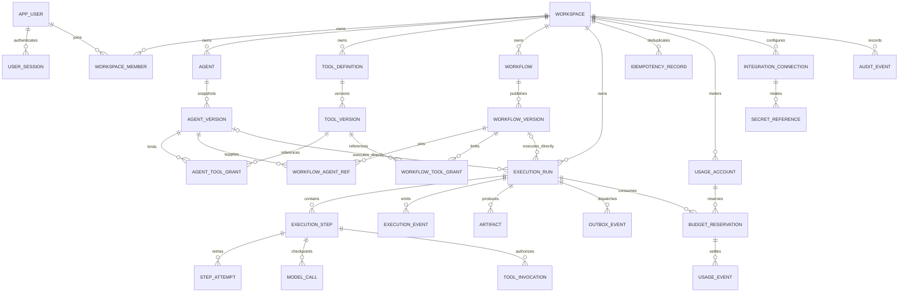

# 02 — PostgreSQL model and invariants

## Storage principles

All tenant records belong to a workspace. Definitions are mutable drafts until snapshotted; immutable version IDs are what runs execute. PostgreSQL holds run truth, checkpoints, event order, budgets and delivery intent. Redis is neither an execution ledger nor a result database.

Use UUIDs, `timestamptz` in UTC, `numeric(18,8)` for USD, explicit state constraints and JSONB for bounded document payloads. Mutable records carry created_at/updated_at and appropriate revision counters. UUIDs are identifiers, not access control. Human-facing local times are formatted in the browser; deadlines compare against database time. Avoid PostgreSQL enums initially where changing CHECK constraints is simpler to migrate.

## ER diagram

The graph's JSONB snapshot is authoritative. There are no duplicate workflow node/edge tables in MVP. Two narrow relational projection tables pin agent/tool references for ownership and archival checks; they are transactionally generated from the graph, never edited separately. Add relational graph tables only for demonstrated graph-query needs.

## Entity details

| Entity | Important fields and rules |
|---|---|
| app_user | id, normalized_email unique, password_hash, disabled_at, created_at. No plaintext password. |
| user_session | id, user_id FK, token_hash unique, csrf_token_hash, created_at, idle_expires_at, absolute_expires_at, revoked_at. Cookies carry opaque random token. |
| workspace | id, name, created_by FK, default limits, active_run_count, active_step_count, concurrency limits, revision, created_at. Membership expresses current authority; created_by does not bypass policy. Concurrency counters are workspace-global, not reset by usage-period rollover. |
| workspace_member | id, workspace_id, user_id, role, timestamps; unique(workspace_id,user_id); protect last owner under workspace row lock. |
| agent | id, workspace_id, name, description, draft_config JSONB, draft_revision, archived_at, created_by; revision ≥1. |
| agent_version | id, workspace_id, agent_id, number, purpose=test/published, config JSONB, config_hash, source_revision, schema_version, created_by/at. unique(agent_id,number); test snapshots cannot be workflow dependencies. |
| tool_definition | id, workspace_id, key, name, revoked_at; unique(workspace_id,key). Represents a trusted installed handler, not uploaded code. |
| tool_version | id, workspace_id, tool_id, number, handler_key/revision, input/output schemas, effect_class, scopes, timeout, retry_safety, connection_id; immutable. unique(tool_id,number). |
| agent_tool_grant | workspace_id, agent_version_id, alias, tool_version_id, restricted scopes/destination IDs; alias unique per agent version. Current revocation is checked separately. |
| workflow | id, workspace_id, name, description, draft_graph JSONB, draft_revision, archived_at, created_by. |
| workflow_version | id, workspace_id, workflow_id, number, graph JSONB, execution_hash, source_revision, schema_version, validator_version, created_by/at; unique(workflow_id,number). |
| workflow_agent_ref | workspace_id, workflow_version_id, node_id, agent_version_id; unique(version,node_id); derived projection. |
| workflow_tool_grant | workspace_id, workflow_version_id, node_id, tool_version_id, scopes/destination IDs; unique(version,node_id); derived projection. |
| execution_run | id, workspace_id, kind, exactly one root version FK, requested_by/member authorization snapshot, state, request limits/effective limits, deadline_at, graph_progress JSONB (runtime edge resolutions), reserved/settled cost summary, input/output artifact IDs, error code, cancel_requested_at, stop_reason, retry_of_run_id, next_event_sequence, timestamps. |
| execution_step | id, workspace_id, run_id, node_id, node_kind, definition references, state, input/output artifact IDs, runtime_checkpoint, selected_branch, next_attempt_at, dispatch_generation, last_dispatched_at; unique(run_id,node_id). Direct agent run has one synthetic `agent` step. |
| step_attempt | id, workspace_id, step_id, number, lease_token, lease_owner, lease_expires_at, heartbeat_at, state, started/finished_at, error code; unique(step_id,number). At most one running attempt per step through partial unique index. |
| model_call | id, workspace_id, step_id, logical_call_key, attempt_id, state=prepared/started/succeeded/rejected/unknown, model/capability/pricing snapshot, request hash, provider_request_id, response artifact, upper-bound reservation, usage status; unique(step_id,logical_call_key). Unknown is not a successful response. |
| tool_invocation | id, workspace_id, step_id, logical_call_key, operation_key, attempt_id, tool_version_id, args hash/artifact, authorization snapshot, idempotency key, effect_class, state, result/error, started/finished_at; unique(step_id,logical_call_key). Each network dispatch gets a new call key; safe retries retain the original operation/idempotency key. |
| execution_event | workspace_id, run_id, sequence, type, step_id, attempt_id, occurred_at, redacted payload; unique(run_id,sequence). Product event history, not debug log dump. |
| artifact | id, workspace_id, run_id, media_type, size, checksum, encrypted payload, key_version, retention_until. Bounded JSON/text in PostgreSQL initially. No unbounded binary uploads. |
| outbox_event | id, workspace_id, run_id, step_id, dispatch_generation, task_kind, available_at, state, claim_token/lease, attempts, published_at, last_error; unique(step_id,dispatch_generation). Payload IDs only. |
| idempotency_record | workspace_id, actor_id, operation, key_hash, body_hash, response_status/resource_id, expires_at; unique(workspace_id,actor_id,operation,key_hash). |
| usage_account | id, workspace_id, period_start/end, limit_usd, reserved_usd, settled_usd, uncertain_usd; unique(workspace_id,period_start). Period spend is separate from workspace-global concurrency. |
| budget_reservation | id, workspace_id, account_id, run_id, amount, consumed/uncertain amounts, state, created/settled_at; one run/account reservation. Deadline remains attached across period rollover. |
| usage_event | id, workspace_id, reservation_id, model_call_id or tool_invocation_id, kind, input/output tokens, amount, pricing revision, measurement=estimated/final/unknown, dedupe_key unique. Corrections append entries rather than silently rewriting charges. |
| integration_connection | id, workspace_id, provider/handler key, display_name, state, revoked_at, credential_generation; no decrypted secret. |
| secret_reference | id, workspace_id, connection_id, generation, ciphertext, nonce, key_version, masked_hint, revoked_at. Unique(connection_id,generation). Runtime resolves active generation, never exposes value in definition. |
| audit_event | id, workspace_id, actor_type/id, action, target_type/id, occurred_at, request_id, redacted metadata. Append-only to application roles. |

## Ownership and constraints

Every tenant-owned row has `workspace_id NOT NULL`. Parents expose unique `(workspace_id,id)` and children reference that composite key. Example: `(workspace_id,agent_id)` → agent `(workspace_id,id)`. This prevents a version belonging to workspace A from pointing to an agent in B even if application code errs. Apply the same pattern to runs, steps, artifacts, grants, connections, reference projections and retry links. Null system audit events belong to a separate operational log, not tenant audit rows.

Root run constraint: kind=agent requires agent_version_id non-null and workflow_version_id null; kind=workflow requires the inverse. Version purpose, JSON graph semantics and permission subset checks require application transaction validation; CHECK constraints cannot inspect arbitrary referenced rows. PostgreSQL supports composite foreign keys and notes the limits of cross-row CHECK constraints. [PostgreSQL constraints](https://www.postgresql.org/docs/current/ddl-constraints.html).

Other checks: positive deadlines/timeouts, revision and version number ≥1, nonnegative counts/amounts, allowed state values, finished_at only for terminal outcomes. FK deletion uses RESTRICT for execution/version history; session cleanup can cascade from a separately approved user removal flow. Archive definitions rather than delete their versions.

Immutable configuration rows and projections reject UPDATE/DELETE for runtime/API DB roles. Publication inserts configuration, projection grants and audit in one transaction. Minimal row trigger additionally prevents accidental version mutation by normal migrations/application roles; migrations must explicitly opt into reviewed backfills. Revocation is mutable on connection/tool root policy records, not by editing historical versions.

## Initial indexes — driven by actual queries

| Index | Query served |
|---|---|
| user_session(token_hash) unique; expiry partial on non-revoked sessions | Login/session lookup, cleanup |
| workspace_member(user_id,workspace_id), unique(workspace_id,user_id) | Workspace list and membership check |
| agent(workspace_id,updated_at DESC,id DESC) WHERE archived_at IS NULL | Agent library |
| workflow(workspace_id,updated_at DESC,id DESC) WHERE archived_at IS NULL | Workflow library |
| agent_version(agent_id,number) unique; workflow_version(workflow_id,number) unique | Version history |
| execution_run(workspace_id,created_at DESC,id DESC) | Stable cursor history |
| execution_run(workspace_id,state,created_at DESC,id DESC) | Status-filtered history |
| execution_run(deadline_at) WHERE state IN ('queued','running') | Deadline reconciliation |
| execution_step(run_id,state), unique(run_id,node_id) | Monitor and scheduling |
| execution_step(next_attempt_at) WHERE state='retrying'; queued dispatch-age index | Retry dispatch and lost-message recovery |
| step_attempt(lease_expires_at) WHERE state='running'; unique(step_id) WHERE state='running' | Recovery and one active claim |
| execution_event(run_id,sequence) unique | Ordered event polling |
| outbox_event(available_at,id) WHERE state IN ('pending','claimed') | Maintenance scan |
| audit_event(workspace_id,occurred_at DESC,id DESC) | Audit feed |

No broad JSONB GIN indexes or full-text search infrastructure initially. Bounded case-insensitive name filtering is enough for small libraries. Add indexes using observed query plans, not every possible filter.

## Transactions and locking

Use READ COMMITTED with explicit row locks and unique constraints. Lock order: workspace → usage account → run → steps sorted by ID → attempts/calls. Budget updates lock account and reservation consistently. Scheduler serializes short changes under the run row, reasonable for ≤100 nodes; never hold locks over network calls. Deadlock/serialization retries are bounded and contain no external effects.

- Draft save: compare expected_revision, update atomically, return new revision; stale save →409.
- Snapshot/publish: lock parent, validate same revision, allocate version number, insert immutable version/projections/audit atomically.
- Submit: authorize, validate root version/input, lock usage account, reserve budget/concurrency, create run/steps/event/outbox/idempotency result in one commit.
- Step finish: verify fencing token and stop state, persist output/call usage, resolve downstream edges, schedule outbox records, append events and possibly finalize run.
- Last-owner change: lock workspace, count owners and update membership in the same transaction.

Events increment a per-run counter under the run lock; sequence is monotonic and reconnect-safe, not a global timestamp order. Public event payloads exclude secret values and sensitive raw artifacts.

## RLS, retention and backup

MVP ownership enforcement uses scoped services, composite FKs, least-privilege database roles and two-tenant tests. PostgreSQL RLS is deferred until its connection-context and worker requirements can be implemented/tested comprehensively; do not suggest RLS is active. Reconsider for enterprise tenant isolation or additional SQL access paths.

Proposed retention: raw artifacts 7 days, sanitized execution events 30 days, run metadata and security audit 90 days; confirm operational requirements before production. Test snapshots are never auto-deleted while referenced by runs. Expire/redact payloads while keeping execution metadata consistent. Backups are encrypted; restore into an isolated environment and verify ownership and ledger consistency. Longer legal/customer retention needs a separate decision, not a silent default.
