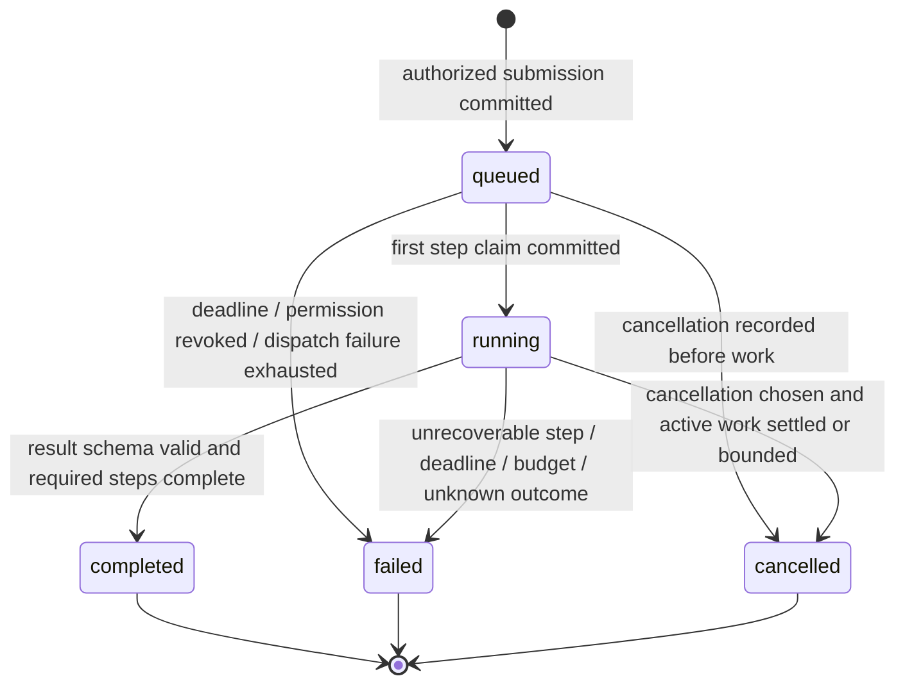
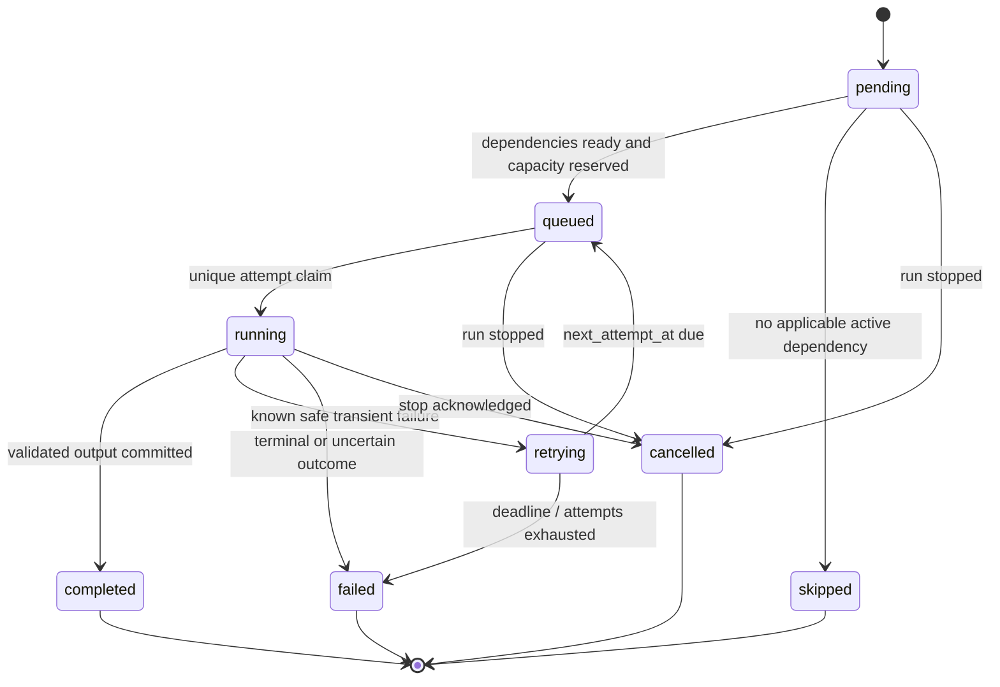
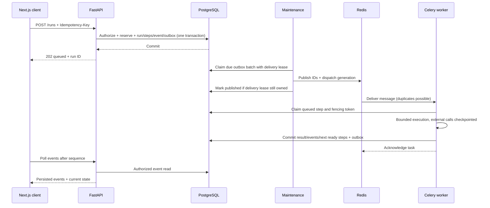

# 04 — execution, delivery and recovery

## What durability means here

After the API accepts a run, its definition, input reference, budget reservation and delivery intent are committed to PostgreSQL. Restarting a worker or losing Redis must not erase that record. Recovery resumes work only where safe; it may return a precise failure when an external result is unknowable. Durability is not a promise that every provider call can be replayed without extra cost.

## Run state machine

Run stays running while a step is retrying; the API exposes retry metadata. Timeout is a failed run with `RUN_TIMEOUT` or `STEP_TIMEOUT`, not another ambiguous success state. Cancellation is a persisted request plus eventual cancelled state; “Cancellation requested” is a UI substate. Terminal runs never become active again. User retry creates a new authorized, budgeted run linked to the original.

### Transition invariants

- Every transition is checked under a row lock or compare-and-set, scoped to workspace.
- First terminal decision wins under run lock; cancellation/deadline is checked before accepting a new result. If completion already committed, cancellation returns that result.
- `stop_reason` is latched for cancellation, deadline or fail-fast error. Once latched, no new external call is authorized. Active worker results may reconcile usage and artifact metadata, but cannot resurrect/succeed the run.
- Finalization releases concurrency and unused reservations only after bounded active-call reconciliation. A cancelled/failed run may retain an uncertain cost hold; UI reports that explicitly.

## Step and attempt state machines

Queued/retrying steps can also fail on run deadline or invalidated permissions. Attempts separately record running/succeeded/failed/lost/cancelled outcomes. Broker delivery is not a new domain attempt: only a successful database claim allocates the next attempt number. Duplicate deliveries while a live claim exists exit without consuming a retry.

## Agent loop and checkpoints

1. API validates schema, ownership and immutable test/published snapshot; reserves run budget/concurrency, creates synthetic root step and outbox intent; returns 202.
2. Agent worker claims step under a lease/fencing token, loads effective policy and last committed checkpoint.
3. Check run stop flags, deadline, iteration/tool limits, current membership, model/connection and tool revocation.
4. Persist model_call prepared record and cost upper-bound reservation. Immediately before network dispatch persist started state. Do not hold DB transaction over network.
5. Call selected provider with SDK automatic retries off, explicit connect/read/total limits and output token cap. Provider adapter maps errors to safe rejection / success / unknown acceptance.
6. Persist response artifact, reported usage and checkpoint atomically. Validate structured final output or requested tool calls; invalid output fails without fabricating a result.
7. For a tool call, validate tool identity, arguments, scopes, destination and effect class. Persist invocation intent/hash/idempotency key, then started state before dispatch. Never trust a provider's tool name or arguments as authorization.
8. Execute bounded approved operation, persist result/usage and checkpoint, then continue from that checkpoint. Execute tool requests sequentially in MVP to simplify cancellation, permissions and budget accounting.
9. Validate final output schema, commit completed step/result/events and settle known charges. Workflow agent nodes complete the same step instead of creating nested blocking run trees.

A bounded agent loop runs inside an agents worker task, not an HTTP handler. Checkpoint after every successful model/tool call; failure recovery must not restart the whole loop. Conversation/request data is encrypted artifact content; the small checkpoint stores references and next logical call index. Pinned handler revision must still be installed; fail explicitly if unavailable.

Allocate a model_call row for every attempted network dispatch, with a new monotonic call sequence, even when retrying the same intended model turn. Tool dispatch rows also record each attempt, while their stable operation/idempotency key remains the same across safe retries. This preserves per-attempt accounting without duplicating the logical tool effect. Persisted started marker checks current fencing token and stop flags in its transaction; an expired worker cannot turn an old prepared checkpoint into a new authorized call.

Provider adapter contract is deliberately small: capabilities, validate options, estimate conservative maximum cost, generate with deadline, normalize result/usage and classify error acceptance. One real provider plus deterministic test adapter. Do not create an agent framework plugin system before a second real need exists.

## Workflow validation and edge resolution

Use Kahn topological sort for cycles and dependency ordering. Semantic checks from contracts run at publication and submission; authorization/revocation rechecked at effects. Invalid graphs never reach scheduling.

Each run stores bounded `graph_progress` JSONB for ≤200 edges: `unresolved`, `activated`, `inactive`. This is runtime state distinct from immutable graph definition. It updates under the run row lock alongside steps; no Redis-only branch state.

When a node completes:

- Normal node activates outgoing out edges.
- Condition evaluates allowed comparison without coercion; selects true or false. Selected edge activates; opposite edge becomes inactive. Persist selection so recovery never reevaluates using different data.
- A skipped node marks its outgoing edges inactive; a failed node triggers fail-fast, not a false branch.
- Repeat downstream resolution until no step state can advance. Do not recursively mark all descendants skipped: another active path may reach a merge.

Ready/skip rules, once all incoming edges are resolved:

| Node join | Activated incoming edges | Decision |
|---|---|---|
| all | Every incoming edge activated | Ready |
| all | At least one inactive | Skipped |
| active | At least one activated | Ready using active mappings only |
| active | None activated | Skipped |

Manual input is initially ready without predecessors. `active` is the precise name for the earlier sketch's “any_active”: it waits for all incoming edges to resolve, not the first result. Validator rejects mutually exclusive writes to the same input only when they can be active concurrently; branch alternatives may map the same required input if every feasible selected path supplies it.

Scheduler applies per-run parallel limit and workspace permits under transaction locks. Queueing reserves a logical active-step slot; completion/retry/stop releases it. Short orchestration/condition/transform/result/tool nodes use workflow_steps pool; agent nodes route directly to agents pool. No workflow worker waits for an agent task result. The same runtime completion transaction resolves new ready steps and writes their outbox rows.

MVP fails fast: a terminal step failure stops new work and requests active siblings to stop; downstream steps are cancelled, not falsely completed. Existing committed outputs remain inspectable. Overall completion requires exactly one valid terminal result and all relevant active work terminal; a skipped required result is a failure `NO_RESULT_PATH`.

## Submission and delivery sequence

## Outbox, reconciliation and ownership

Maintenance runs two bounded periodic loops in one process initially. Outbox loop claims due rows using row locks and SKIP LOCKED, writes a delivery lease, commits, publishes IDs, then marks success. Never hold a database transaction while waiting on Redis. Crash after publish/before marking delivered can duplicate a message; step claim is the defense. SKIP LOCKED is suited to queue consumers rather than general consistent reads. [PostgreSQL SELECT locking](https://www.postgresql.org/docs/current/sql-select.html).

Reconciliation loop checks:

- queued steps unclaimed beyond dispatch grace: increment dispatch_generation and write new unique outbox intent, including when the previous intent was marked published;
- due retrying steps: queue with new dispatch generation;
- expired running leases: fence old attempt, inspect checkpoints/call outcomes, resume only safe work or fail uncertain outcomes;
- exceeded run deadlines/stop requests: prohibit new calls, finalize after active work is bounded;
- abandoned outbox claims and stale maintenance/worker heartbeats;
- ledger/concurrency invariants from persisted reservations, with repair events audited.

Thus Redis restart/loss is recoverable even for previously published messages. Queue grace starts at 30s; repeated redelivery is capped by run deadline and dispatch policy. Persisted `next_attempt_at` controls delays; avoid long broker ETA/countdown tasks or worker sleeps.

## Celery settings policy

JSON-only broker messages containing IDs/generation/correlation ID, never instructions, secrets or user inputs. Use late acknowledgement for tasks whose database state makes repeated delivery safe, ignore Celery result storage, prefetch multiplier 1 initially, explicit queue routing, bounded concurrency and separate worker identities. Default workers: agents concurrency 2; workflow_steps concurrency 2 (development). Tune after measuring provider limits and DB load.

Do not rely on `acks_late` alone for crash recovery: Celery documents cases where child termination still acknowledges the task. Leave reject-on-worker-lost disabled initially and let durable reconciliation decide safe retries; enabling it later requires poison-task tests and application attempt bounds. Every task entry still consults PostgreSQL. [Celery task delivery guidance](https://docs.celeryq.dev/en/stable/userguide/tasks.html).

Set Redis visibility timeout above maximum bounded task runtime plus margin (proposal 600s for a 300s run cap). Verify exact transport settings against the pinned Celery/Kombu versions; Redis redelivery behavior is not an exactly-once guarantee. Avoid configuring Redis as a result backend. [Celery Redis transport](https://docs.celeryq.dev/en/stable/getting-started/backends-and-brokers/redis.html).

## Failure/recovery matrix

| Failure point | Durable evidence | Recovery |
|---|---|---|
| API dies before commit | No accepted run transaction | Client repeats same idempotency key |
| API dies after commit, before response | Run + stored command response | Same key returns existing run |
| Relay dies before publishing | Pending or expired outbox claim | Relay reclaims |
| Relay dies after publish | DB may still say pending | Republish; unique step claim prevents second active attempt |
| Redis loses published work | Queued step remains unclaimed | Reconciler redispatches with new generation |
| Worker dies before claim | Queued step | Redelivery/reconciliation |
| Worker dies after claim, before external started marker | Prepared checkpoint | Fence old attempt; retry safe checkpoint within limits |
| Worker dies after model started, before persisted response | Model call started, no known result | Mark unknown; fail `PROVIDER_OUTCOME_UNKNOWN`, retain cost hold; no blind model replay |
| Provider explicitly rejects without acceptance | Adapter evidence of safe rejection | Retry with bounded backoff if deadline/budget permits |
| Read-only tool times out | No write effect, usage known or capped | Retry only if installed handler declares safe and within limits |
| External write result lost | Possible effect, no reliable receipt | MVP write tool disabled; future system requires idempotency/queryable receipt or manual resolution |
| Worker dies after result commit, before broker ack | Completed step/checkpoint | Duplicate task exits or resumes next uncommitted safe checkpoint |
| Lease expires while old worker is alive | Old token invalidated | Old result cannot commit; no replacement external effect while acceptance uncertain; fail closed/reconcile |
| Database unavailable during effect | Call may have happened, no commit | Stop further effects; recover as unknown unless receipt can be proven |
| All workers offline | Queued runs and DB deadlines remain | Health alert; maintenance expires overdue work; UI shows queued then actual persisted failure |

Database fencing blocks stale database writes; it cannot remotely cancel a provider request. A started marker may precede a call that never actually happened, so this conservative policy can fail a run unnecessarily. That is preferable to quietly duplicating charge/effect. Add safe provider receipt lookup only if the actual provider supports it.

## Timeouts, cancellation and retries

Proposed time bounds: run default 60s/hard ceiling 300s including queue time; tool ≤10s default; provider call ≤30s default, clamped to remaining deadline. Lease 30s, heartbeat 5s, reconciliation 5s, outbox scan 1s. These are development policy starting points, not SLO claims. Worker heartbeat renewal checks token ownership and stop flags; losing lease prevents new calls immediately.

Deadline uses persisted absolute time; retry never resets it. Client timeouts do not cancel runs. Cooperative cancellation is checked before each external call and between calls. Cancel waits only within bounded call deadline; after that, final state can be cancelled with unresolved charge hold. Late receipts update usage metadata only. Never send Celery terminate as the normal user-cancel mechanism; killing a process does not undo remote effects.

Retry only classified safe errors. Exponential delay with jitter: uniform(0,min(10s,base×2^(attempt−1))), respect bounded Retry-After when within deadline. Definition error, invalid schema, denied tool, unknown provider acceptance, budget exceeded and revoked connection are terminal. No generic autoretry(Exception). Persist attempt/backoff in DB; SDK, broker and application retries must not multiply independently.

## Budgets and usage accounting

Two levels: workspace account reserves a run's cap at submission; run ledger allocates call upper bounds inside that cap. Do not charge the workspace twice for a child reservation. Reject if settled + uncertain + reserved + requested exceeds period quota. Reserve workspace-global concurrency atomically in the same transaction; period rollover cannot grant duplicate active-run slots. Proposed usage periods are calendar months in UTC, with a run and its late receipts attributed to its submission period. Reclassification of a reserved call as uncertain moves the amount between ledger categories; it does not count the same hold twice. These are usage-control conventions, not a commercial billing product.

Before each call, count serialized input conservatively, cap output tokens and include known tool charges/overheads. Enforce max iterations/tool calls independently of money. Retry consumes the same original run allowance. Record pricing revision and whether costs are estimated, provider-final or unknown. No reliable cost upper bound → monetary-capped call cannot start. Provider adapter validation must prove that its estimates cover tokenization/hidden billable categories or reject that capability.

Example: $0.10 run cap; $0.02 settled; $0.03 in-flight reserved; remaining call capacity $0.05. A $0.06 maximum call is denied before dispatch. On unknown acceptance, retain that call's maximum as uncertain; release only unused remainder. On final receipt, replace hold with measured charge through ledger correction. Alert if provider reports more than the assumed bound; do not hide overage or claim absolute provider-billing control. Administrative resolution of unknown usage is audited and not an MVP auto-release timer.

## Recovery acceptance tests

Real Postgres/Redis + actual Celery process tests, controlled fake provider/HTTP server. Kill worker at every boundary in the matrix; clear Redis; kill maintenance after publish; deliver same task twice; expire lease; race cancellation/completion; simulate DB outage during effect; run concurrent spend reservations. Assert one authoritative outcome, no unsafe replay, no lost accepted work, bounded attempts, preserved checkpoints, accurate holds and reconnect-safe event history. Celery eager mode alone cannot establish these properties.
