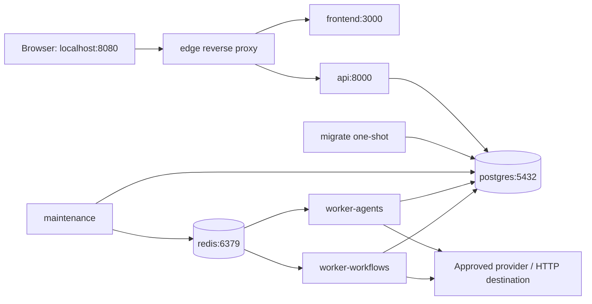

# 06 — development topology, testing and observability

## Docker Compose proposal

Linux containers on Docker Desktop/WSL2 for Windows development. Backend workers run in Linux containers; do not depend on Windows-specific Celery pool behavior. The following is topology documentation, not a Compose scaffold.

| Service | Responsibility | Development dependencies/readiness |
|---|---|---|
| edge | Same browser origin, route `/api/v1` to API, remaining pages to Next.js | Upstream connectivity; published localhost port only |
| frontend | Next.js dev server, production build mode in CI | API reachable for authenticated reads; no database credentials |
| api | FastAPI HTTP, definitions/auth/run submission/read views | PostgreSQL healthy + migrations complete; not hard-dependent on worker being online |
| postgres | Durable data, artifacts and ledger | pg readiness + schema version; named volume |
| redis | Celery broker, bounded shared rate counters | Redis ping/auth; named volume/AOF for convenience, never sole recovery path |
| migrate | Alembic upgrade, one-shot job | PostgreSQL healthy; exit successful before API/workers |
| maintenance | Outbox relay, leases/deadlines/retry reconciliation | Schema ready; DB required; Redis failure is retried with bounded backoff |
| worker-agents | Bounded model/tool loops, agents queue | Schema ready and broker available |
| worker-workflows | Condition/transform/result/approved tool steps | Schema ready and broker available |

No integrations pool, Celery Beat, Flower, Prometheus or tracing collector required for first boot. Add optional observability profile for Prometheus/Grafana after metric instrumentation exists. Introduce dedicated integration queue only with an implemented connector/use case.

Compose startup conditions wait for health and successful migration, not just container creation. Applications still retry transient dependency failures after startup; order alone does not provide ongoing availability. [Docker Compose startup order](https://docs.docker.com/compose/how-tos/startup-order/).

Use separate edge/data networks and explicit service access; default private ports not exposed to host. Optional localhost-only DB debug profile. Nonroot app containers, resource caps, read-only root where practical, writable temporary directory only, no Docker socket mounts. Dev bind mounts are development-only. Use distinct API/worker/migration DB roles. Do not mistake Docker networks for production egress allowlists.

Database role boundary: migration role owns DDL/backfills; API role handles identity/membership/draft creation and append-only version publication plus run submission/cancel commands; runtime role reads approved definitions and writes execution/checkpoint/event/usage/outbox records but cannot edit users/membership/versions; maintenance role reads/reconciles runtime/outbox records without definition/security mutations. Audit writes are append-only. These are explicit table/column privileges, not a substitute for row-level workspace checks. Keep connection-role setup in reviewed migrations and test forbidden statements.

Environment examples contain names only: database DSNs by role, broker URL, public origin, internal API URL, cookie mode, encryption key-file path, log level and platform caps. Provider credential belongs in encrypted workspace connection records, not frontend env. Local untracked secrets/DB data never committed. Validate required configuration and fail clearly when missing; no silently generated production encryption key.

Health distinction: API liveness says process alive; readiness says database/schema can serve traffic. Runtime capability endpoint exposes actual pool/broker health to authorized dashboard without declaring API unready whenever workers pause. Worker/process heartbeat lives in a small operational record; metrics include last completed/claimed work so “process alive but stuck” is detectable. Maintenance outage must alert: broker redelivery alone is insufficient.

## Testing layers and evidence

| Layer | Purpose | Initial cases |
|---|---|---|
| Pure unit | Fast rule tests, no infrastructure | State transitions, DAG cycles, branches/joins, pointer mappings, permission intersections, cost arithmetic |
| Postgres integration | Real constraints and transaction behavior | Composite ownership FKs, immutable versions, last owner, revision races, unique attempt claim, spend reservations |
| API contract | FastAPI request/response/role behavior | Auth/CSRF, pagination/cursors, error envelope, draft/version/run endpoints, viewer artifact denial |
| Worker integration | Real Redis/Celery delivery with deterministic external server | Queue routing, checkpoint persistence, retry scheduling, no Celery result dependency |
| Recovery/chaos | Prove restart invariants | Kill workers/maintenance, broker loss, duplicate tasks, lease expiry, unknown response, cancel/finish race |
| Frontend unit/component | Meaningful interaction behavior | Form/schema errors, dirty/save conflicts, palette/inspector changes, validation selection, event reconnect |
| Security | Boundaries, not just happy paths | SSRF variants, prompt-injected calls, secret canaries, cross-tenant enumeration, revoked membership |
| Manual product review | Responsive usability | All 15 screens, keyboard/list canvas alternative, 200% zoom, reduced motion, empty/loading/error states |

Use pytest + real PostgreSQL for transactional/locking tests; SQLite cannot establish Postgres semantics. Deterministic provider/HTTP test fixtures never report live model integration. Opt-in provider smoke tests use isolated credentials and small cost caps; they are not required on every PR. No untrusted fork receives secrets.

Frontend checks: TypeScript, ESLint, meaningful component tests and Next.js production build. No tests that simply assert implementation constants or snapshot every wrapper. No automated browser screenshots unless requested. Browser functional end-to-end tests can be added when stable user journeys warrant them; do not require them before a feature exists.

## CI gates

1. Frozen dependency installs and secret/dependency scanning. Lock exact dependencies after compatibility checks; update through reviewed changes.
2. Backend format/lint and type checks on typed module boundaries; pure unit tests.
3. PostgreSQL/Redis service jobs: migrations from clean DB, API/constraint/security integration tests.
4. Real worker recovery suite on runtime-related changes; run full recovery suite before release. Avoid eager-mode-only false confidence.
5. Frontend typecheck/lint/component tests, generated OpenAPI DTO drift check and production build.
6. Build backend/frontend containers, run health smoke checks and reviewed migration compatibility test. No automatic production deployment from unapproved changes.

Keep CI scripts in repository and report exact successful/failed checks. Migration CI covers fresh install and upgrade from previous released schema. Prefer additive/backfill/remove migrations across releases; do not assume every destructive migration has a safe downgrade.

## Structured logging

Emit JSON to stdout: timestamp, level, service, event_name, request_id, correlation_id, workspace_id, run_id, step_id, attempt_id, dispatch_generation, duration_ms, error_code. Missing context is null/omitted, not fabricated. IDs appear in logs/traces, not high-cardinality metrics labels.

Never log passwords, session/CSRF tokens, secret values, authentication headers, complete prompts, tool arguments or raw outputs. Detailed payloads belong in access-controlled encrypted artifacts with retention, not unrestricted observability. An operational trace records calls/timings/errors, never model private reasoning.

## Metrics and alerts

Measure API latency/error rate; DB pool wait/lock duration; outbox pending count/oldest age; queued steps/claim latency; worker last heartbeat/last progress; task duration; expired leases/recovery count; retry counts; run/step states; provider latency/error class; token consumption; settled/reserved/uncertain costs; permission denials and budget rejections.

Low-cardinality labels: service, queue, state, provider key, safe error class. Never label metrics with workspace/user/run UUIDs. Authorized UI aggregates per-workspace usage from Postgres read queries/ledger; operational metrics don't become billing truth.

Initial alerts: maintenance heartbeat missing, outbox age rising, queued work with no worker progress, DB unavailable, repeated lease loss, provider error surge, unknown usage growth and reservation invariant mismatch. Thresholds start as pilot hypotheses and get tuned from real latency; do not advertise an SLA before load/recovery evidence. Start with correlated logs and counters; add OpenTelemetry spans when cross-process debugging justifies collector operations.

## Capacity, retention and deployment readiness

Development concurrency is intentionally small. Bound DB connections across API+worker processes before increasing pools. A Redis queue is not fairness: per-workspace admission/concurrency limits prevent one tenant flooding execution, while priority/scheduling changes wait for measured demand.

Before public production: email recovery/verification, real TLS/cookies, tested SSRF egress restrictions, encrypted key/backup management, role/security tests, restore rehearsal, retention policy, alert ownership, migration rollback/runbook and dependency patch process. Define target RPO/RTO and demonstrate them with the chosen production storage before promising numbers. Infrastructure vendor and billing are deferred decisions; no speculative cloud stack is required for local MVP.
