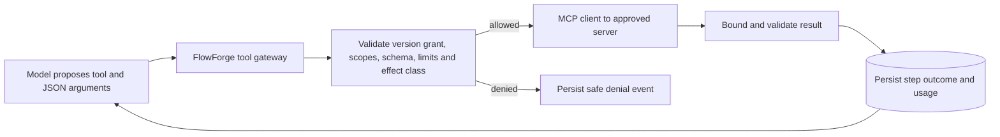

# 09 — Tools, MCP connections and hosted deployments

Status: local tool harness, curated MCP connections, reviewed read-only MCP workflow nodes, durable workflows, and version-pinned hosted endpoints are implemented as local development slices. Agent-initiated MCP calls, write operations, and public production hosting still require the security work below.

## Product path

FlowForge hosts definitions and execution. A customer connects an external service once in a workspace, explicitly grants selected operations to a published agent or workflow version, and can later expose that version through a stable deployment endpoint. Connecting a service does not grant every agent access to it. Publishing a version does not automatically create a public endpoint.

MCP has two distinct roles here:

- **FlowForge as MCP client (build first):** the runtime calls tools on approved external MCP servers so agents and workflow steps can access services.
- **FlowForge as MCP server (later):** external MCP hosts can discover and invoke a customer's deployed FlowForge agents/workflows. This is an additional product interface, not required for our agents to use external services.

Use the maintained Python MCP client with a pinned, tested protocol/SDK version. Prefer remote Streamable HTTP for hosted connections. Do not let tenants upload arbitrary Python/JavaScript or spawn arbitrary stdio commands on shared workers. Older SSE transport is a compatibility exception, not the default. The [current MCP release](https://blog.modelcontextprotocol.io/posts/2026-07-28/) and [Python client transport documentation](https://py.sdk.modelcontextprotocol.io/client/transports/) must be checked when the integration is coded because protocol behavior changes.

## Registry and authorization model

1. A platform-reviewed connector profile fixes an MCP server identity, allowed HTTPS endpoint/origin, OAuth issuer and permitted operations. Workspace admin installs it and authorizes the minimum service scopes. Later, custom remote MCP servers require a hardened egress proxy and explicit review.
2. On installation, discover tools and store a snapshot of each tool's name, input/output schema, description hash, connection identity and last-seen time. Sanitize and bound descriptions. Treat discovered text and annotations as untrusted metadata; a server can change its claims. [MCP's tool-annotation guidance](https://blog.modelcontextprotocol.io/posts/2026-03-16-tool-annotations/) explicitly calls annotations hints rather than authorization guarantees.
3. Admin approves selected tools and resource scopes for the workspace. An editor grants a subset to one agent draft or workflow tool node. Publication freezes tool IDs, schema hashes, effect class, call limits and allowed scopes with the version. Changed remote schemas or expanded scopes require reapproval and a new version.
4. Every invocation computes effective authority as platform policy ∩ workspace installation ∩ frozen version grant ∩ current credential scopes ∩ runtime limits. Recheck tenant ownership, revocation and scopes immediately before the call. A model's proposed tool name or arguments never create permission.
5. Read-only tools can run after validation. External writes need a separate approval and idempotency/receipt design; do not infer safety from a remote server's `readOnlyHint`. Record who approved, what was sent, the remote result and whether retry is safe.

The connector credential belongs to the workspace or a specific user as required by that service. Store encrypted tokens server-side; never put them in agent instructions, workflow JSON, browser bundles, Celery messages or templates. OAuth authorization must bind tokens to the expected issuer/resource and requested scopes. Rotation and revoke stop future calls. A token obtained for one MCP server must never be forwarded to another.

## One tool call

The worker persists a tool-call intent and a deterministic call ID before external effects. It sends only the allowed arguments. Read results are bounded by timeout, bytes, JSON depth and call count; secret-bearing fields are redacted before logs or model context. Tool output is data, never an instruction to change grants. On crash, retry only a proven idempotent read or a remote operation with a verified idempotency key. An uncertain write is held for review rather than replayed.

Remote MCP endpoints and OAuth discovery create SSRF risk. The egress layer must enforce HTTPS, approved hosts and paths, DNS/IP validation at connection time, redirect restrictions, network-level blocks on internal/metadata addresses, and response limits. The existing [security design](05-SECURITY.md) describes the acceptance tests. Do not expose arbitrary tenant-supplied URLs before those tests pass.

## Templates and deployments depend on this boundary

Agent/workflow templates contain tool **requirements**, not credentials or active grants. Installing a template creates an editable draft with unbound connectors. The user sees missing connections/scopes, approves them, tests, then publishes. A hosted deployment points to an immutable version with known grants; the public invoke API cannot add tools or broaden scopes per request.

## Revised vertical slices

| Order | Slice | User-visible acceptance |
|---|---|---|
| 1 | Registry foundation | Admin sees available trusted tools and install state; schema, tenant, role and audit tests pass. |
| 2 | Local read-only tool | Agent uses one bounded built-in operation; denied calls and results appear in the run trace. |
| 3 | Remote MCP read-only connector | Admin connects one reviewed Streamable HTTP server, discovers/approves tools, grants one to an agent, and a real worker call succeeds through the gateway. Fake-server tests cover schema drift, revocation, SSRF, prompt injection, timeout and duplicate delivery. |
| 4 | Workflow tool step | Published workflow version runs the approved tool node with persisted step state, mappings and recovery. |
| 5 | Additional connectors and writes | Add reviewed service profiles one by one; write operations require approval, remote idempotency or explicit non-retry handling. |
| 6 | Hosted deployment API | Scoped customer API keys invoke published versions with quotas and monitoring. Templates follow once install/grant flows are stable. |

Do not allocate a container per agent initially. Shared, bounded worker pools with workspace fairness are simpler to operate; isolate connector execution pools or customers when measured load, compliance or trust boundaries require it.

